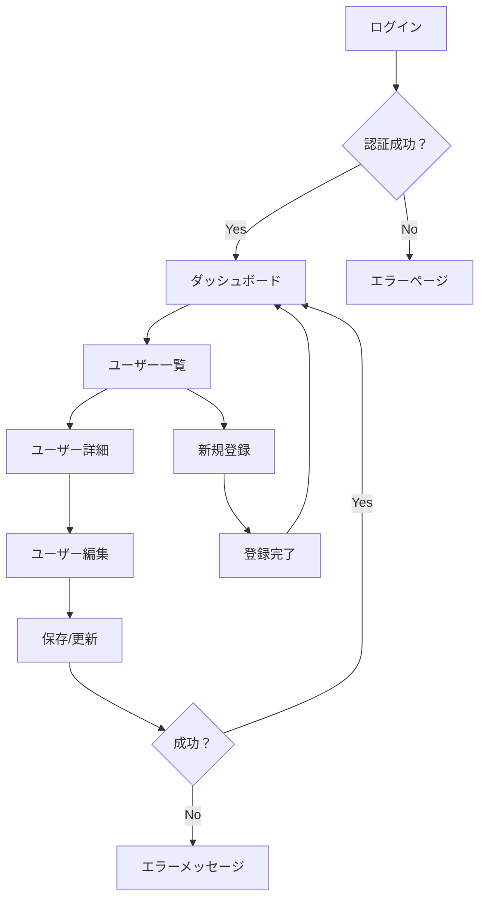
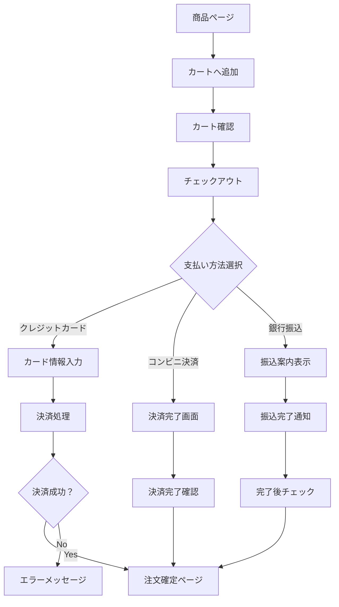
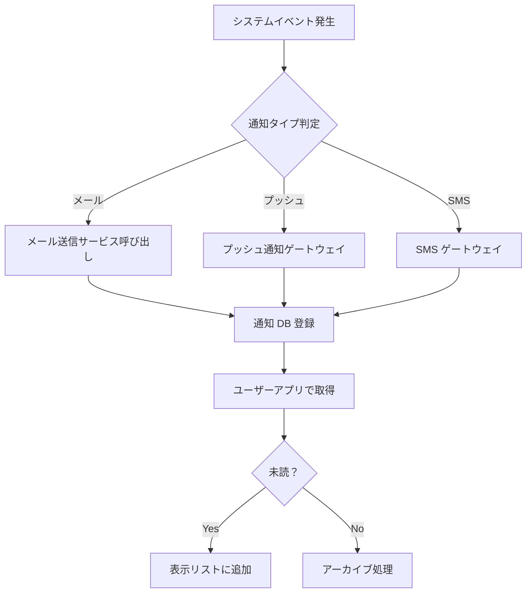

# 画面遷移図（Screen Flow）

## 1. ユーザー管理フロー



### 1.1 ユーザー管理詳細ページ構成
- **ヘッダー**: ログアウト、通知アイコン
- **メインエリア**: 
  - ユーザー一覧テーブル（検索、ソート機能）
  - ページネーション
- **サイドバー**: 
  - ユーザー統計
  - 最近のアクティビティ

## 2. 決済フロー



### 2.1 チェックアウトページ構成
- **ステップインジケーター**: 情報→配送→支払い→確認
- **フォームエリア**: 
  - 配送先住所入力
  - 支払い方法選択
- **要約エリア**: 
  - 商品一覧と合計金額
  - クーポンコード入力

## 3. 通知フロー



### 3.1 通知センター構成
- **フィルター**: 未読/既読、タイプ別（メール/Push/SMS）
- **一覧表示**: 
  - タイトル、本文、日時
  - 開封状態のアイコン
- **アクション**: 
  - 詳細表示
  - 削除
  - マークして読み込み

## 4. 共通画面要素

### 4.1 ヘッダーコンポーネント
```
┌─────────────────────────────────────┐
│ ロゴ │ メニュー │ ユーザーアイコン   │
└─────────────────────────────────────┘
```

### 4.2 フッターコンポーネント
```
┌─────────────────────────────────────┐
│ お問い合わせ │ プライバシーポリシー │
└─────────────────────────────────────┘
```

### 4.3 エラーページテンプレート
```
┌─────────────────────────────────────┐
│                    🚫                │
│                  エラー              │
│               詳細メッセージ         │
│                   [戻る]             │
└─────────────────────────────────────┘
```

## 5. レスポンシブ対応

- **デスクトップ**: 3 列レイアウト（サイドバー＋メイン＋ナビゲーション）
- **タブレット**: 2 列レイアウト（サイドバーを折りたたみ可能）
- **モバイル**: 1 列レイアウト（ハンバーガーメニュー）

## 6. アクセシビリティ要件

- WCAG 2.1 AA 準拠
- キーボードナビゲーション対応
- スクリーンリーダー対応